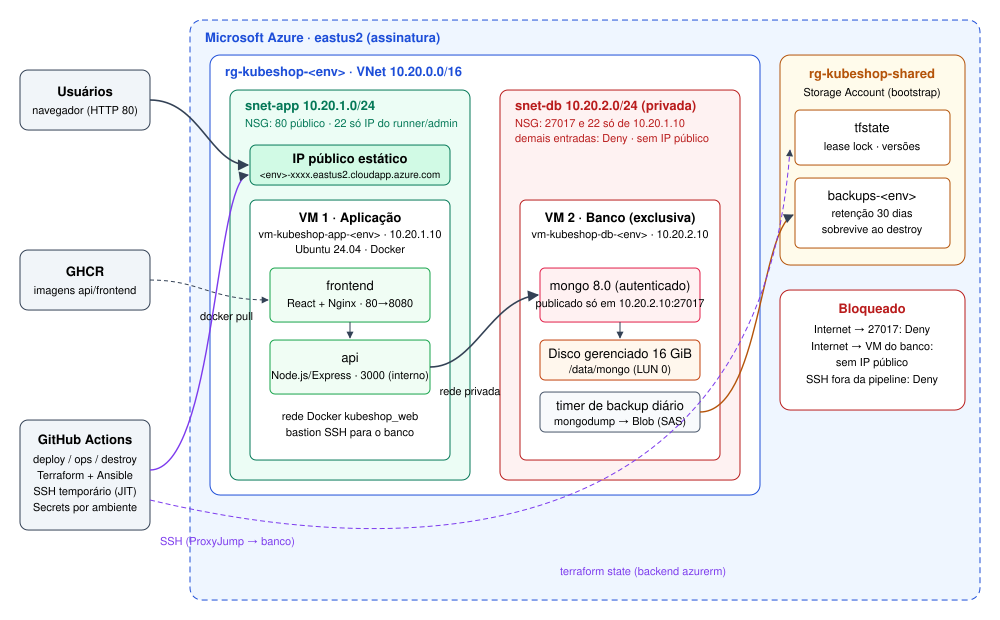

# KubeShop

> **PM04 · Projeto Final — Infraestrutura como Código + SRE.** Este fork adiciona a infraestrutura em nuvem do KubeShop (Azure) com **Terraform**, **Ansible** e **GitHub Actions**, atendendo ao `escopo.pdf` da Zibiska Korp. A aplicação original continua intacta em `apps/` (execução local descrita mais abaixo).

## Infraestrutura em nuvem (PM04)



Duas VMs Ubuntu 24.04 na Azure: **aplicação** (Nginx + API em Docker, IP público, porta 80) e **banco** (MongoDB autenticado em VM exclusiva, **sem IP público**, porta 27017 aceita só a VM da aplicação pela rede privada, dados em disco gerenciado separado, backup diário para Blob Storage).

```
.github/
  workflows/
    bootstrap.yml      0 - Infra | Bootstrap (state + backups, uma vez)
    deploy.yml         1 - Infra | Provisionar e configurar (Terraform -> Ansible)
    ops.yml            2 - Infra | Operação (health, logs, restart, backup, restore, smoke, deploy-app)
    destroy.yml        9 - Infra | Desativar ambiente
    app-images.yml     App | Build e publicação das imagens (CI/CD da aplicação)
  actions/             tf-init e ssh-access (passos reutilizados)
terraform/             providers, backend, variables, network, compute, backup, outputs
ansible/
  playbook.yml         configuração completa (executada pelo deploy)
  ops-*.yml            rotinas de operação
  group_vars/          valores padrão (sobrescritos pelos parâmetros da pipeline)
  roles/               os_updates, packages, docker, data_disk, mongodb, backup, app, verify
scripts/infra/         bootstrap, inventário a partir dos outputs, SSH temporário
docs/infra/            documentação (arquitetura, preparação, operação, custos, CI/CD, validação)
evidencias/            prints e links das execuções
```

| Documento | Conteúdo |
|---|---|
| [1. Arquitetura](docs/infra/01-arquitetura.md) | Diagrama, decisões, justificativas, requisitos × implementação, limitações |
| [2. Preparação](docs/infra/02-preparacao.md) | Service principal, chave SSH, Secrets, Variables, Environments, primeira execução |
| [3. Operação](docs/infra/03-operacao.md) | Parâmetros, rotinas, backup/restauração, acesso ao banco, desativação, falhas comuns |
| [4. Custos](docs/infra/04-custos.md) | Estimativa mensal com premissas e fontes |
| [5. Integração CI/CD](docs/infra/05-integracao-cicd.md) | Contrato com o pipeline da aplicação e segredos necessários |
| [6. Validação](docs/infra/06-validacao.md) | Cenários 1–3 do PM04 e critérios ACE-01..10 |

**Início rápido:** configure os Secrets/Variables ([cap. 2](docs/infra/02-preparacao.md)) → rode `0 - Bootstrap` → `App | Build` com `version=1.0.0` → `1 - Infra` com `environment=dev`, `action=apply`.

---

## Aplicação (execução local original)

O KubeShop é um projeto didático para o Laboratório de Engenharia de Software do professor Laercio. O objetivo é praticar o deploy de uma aplicação em nuvem, desde a preparação do ambiente até a publicação e a verificação dos serviços.

A aplicação simula uma loja virtual com catálogo, carrinho e histórico de pedidos. Ela reúne uma interface em React servida pelo Nginx, uma API em Node.js/Express e um banco MongoDB com armazenamento persistente. Essa estrutura permite trabalhar com containers, comunicação entre serviços, configuração do ambiente e persistência de dados durante as atividades do laboratório.

Os produtos e pedidos são fictícios e o histórico é compartilhado entre os usuários da loja. Não há login de clientes nem pagamentos reais.

## Como rodar localmente

### 1. Prepare o ambiente

- Instale o [Git](https://git-scm.com/).
- Instale e inicie o Docker, com suporte a containers Linux e Docker Compose v2.20 ou superior. No Windows, use o [Docker Desktop](https://www.docker.com/products/docker-desktop/) com o mecanismo de containers Linux.
- Deixe a porta `8080` disponível. A primeira execução precisa de internet para baixar as imagens e dependências.

Não é necessário instalar Node.js ou MongoDB no computador: o preparo e a execução usam Docker.

### 2. Clone o repositório

```sh
git clone https://github.com/LaercioMLB/kube-shop-v2.git
cd kube-shop-v2
```

Execute os próximos comandos dentro dessa pasta.

### 3. Gere a configuração e as credenciais

No **Windows**, pelo PowerShell:

```powershell
powershell -NoProfile -ExecutionPolicy Bypass -File .\scripts\setup.ps1
```

No **Linux**:

```sh
sh scripts/setup.sh
```

O script cria o arquivo `.env` e gera as senhas do banco na pasta `.secrets/`. Se esses arquivos já existirem, serão preservados.

### 4. Configure o acesso local

Abra o arquivo `.env` e ajuste estas variáveis:

```dotenv
BIND_ADDRESS=127.0.0.1
HTTP_PORT=8080
```

Assim, a loja fica acessível apenas pelo seu computador. Se a porta `8080` estiver ocupada, escolha outra em `HTTP_PORT` e use essa porta no endereço de acesso.

### 5. Suba os serviços

```sh
docker compose up -d --build --wait --wait-timeout 240
```

O comando constrói as imagens e inicia o frontend, a API e o MongoDB. Aguarde os três serviços ficarem saudáveis (`healthy`).

### 6. Abra a loja

Acesse **[http://localhost:8080](http://localhost:8080)** no navegador.

Explore o catálogo, adicione um produto à sacola e confirme um pedido fictício. Depois, consulte o resultado em **Meus pedidos**.

### 7. Verifique o funcionamento

Confira o estado dos serviços:

```sh
docker compose ps
```

Execute o teste funcional:

```sh
docker compose exec -T api node /app/scripts/smoke.mjs
```

O teste verifica a página inicial, a API, o catálogo e a criação e consulta de um pedido fictício. O resultado esperado é `"result":"PASS"`.

## Consultar logs e encerrar

Para acompanhar os logs:

```sh
docker compose logs --tail=100 -f
```

Use `Ctrl+C` para sair da visualização dos logs. Os serviços continuam em execução.

Para desligar o projeto:

```sh
docker compose down
```

Esse comando remove os containers e as redes do projeto, preservando os volumes com os pedidos. Mantenha também a pasta `.secrets/`, pois ela contém as credenciais do banco. A opção `--volumes` remove os dados persistidos.

Para iniciar novamente, execute o comando do passo 5.
