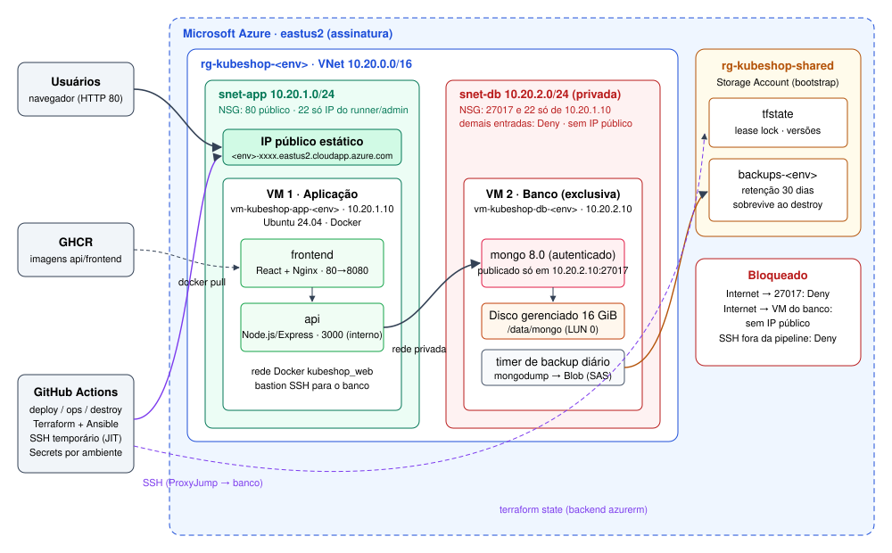

# 1. Arquitetura e decisões técnicas

## 1.1 Visão geral

| Componente | Recurso | Função |
|---|---|---|
| VM 1 · aplicação | `vm-kubeshop-app-<env>` (Standard_B1ms, Ubuntu 24.04) | Docker com `frontend` (React + Nginx, porta 80) e `api` (Node.js/Express, só na rede Docker interna). Também é o bastion SSH para o banco. |
| VM 2 · banco | `vm-kubeshop-db-<env>` (Standard_B2s, Ubuntu 24.04), **sem IP público** | Docker com `mongo:8.0.17` autenticado, porta publicada **apenas** no IP privado `10.20.2.10`. |
| Disco de dados | `disk-mongo-<env>` (Standard SSD 16 GiB, LUN 0) | `/data/mongo`. Recurso separado da VM: resize ou recriação da VM não apaga os pedidos. |
| Rede | VNet `10.20.0.0/16`, `snet-app` `10.20.1.0/24`, `snet-db` `10.20.2.0/24` | Separação em sub-redes com NSG próprio. IPs privados fixos (`.10`). |
| NSG app | `allow-http` (80, Internet) · `allow-ssh-admin` (opcional, CIDRs da equipe) · `gha-ssh-<run>` (temporária) | Entrada pública somente pela loja. |
| NSG db | `allow-mongo-from-app` (27017 de `10.20.1.10/32`) · `allow-ssh-from-app` (22 de `10.20.1.10/32`) · `deny-all-inbound` (4000) | Banco acessível somente pela VM da aplicação; anula a regra padrão AllowVnetInBound. |
| IP público | Standard estático + DNS `kubeshop-<env>-xxxxx.eastus2.cloudapp.azure.com` | Endereço da loja. |
| Compartilhado | `rg-kubeshop-shared` / storage account (bootstrap) | Container `tfstate` (state remoto com lock) e `backups-<env>` (retenção 30 dias). Fica fora do RG do ambiente para sobreviver ao `destroy`. |
| Pipelines | GitHub Actions | `0-bootstrap`, `1-deploy` (Terraform → Ansible), `2-ops` (rotinas), `9-destroy`, `app-images` (CI/CD da aplicação). |

## 1.2 Fluxo de uma execução do pipeline `1 - Infra | Provisionar e configurar`

1. **validate**: `terraform fmt -check`, `terraform validate`, `ansible-playbook --syntax-check`, `ansible-lint`.
2. **terraform init** com backend `azurerm` (state `kubeshop-<env>.tfstate`).
3. **terraform plan -detailed-exitcode**: distingue *sem mudanças* (cenário 3) de *com mudanças*; o plano vira artefato.
4. **Proteção**: se o plano destruir/recriar VM ou disco do banco, a pipeline para (a menos que `allow_replace=true`).
5. **terraform apply** do plano salvo (somente com `action=apply` e se houver mudanças).
6. **SSH just-in-time**: cria a regra NSG `gha-ssh-<run>` liberando a porta 22 apenas para o IP do runner; é removida no fim, mesmo com falha.
7. **Inventário** gerado dos outputs do Terraform (`scripts/infra/render-inventory.sh`); o banco é acessado por `ProxyJump` via VM da aplicação.
8. **ansible-playbook playbook.yml** com os parâmetros (`-e @extra-vars.json`): `os_updates` → `packages` → `docker` → `data_disk` → `mongodb` → `backup` → `app` → `verify`.
9. **Smoke externo**: `/api/health/ready`, catálogo com 6 produtos, versão publicada e teste de que `27017` no IP público **não** responde.
10. Resumo da execução (parâmetros, plano, PLAY RECAP, inventário) no *Job Summary* do GitHub.

## 1.3 Decisões e justificativas

| Decisão | Justificativa |
|---|---|
| **Azure** (`eastus2`) | Provedor usado nas aulas do PM04 e com crédito do Azure for Students; `eastus2` tem B-series disponível e preço menor que `brazilsouth`. A região é variável (`AZURE_LOCATION`). |
| **Terraform** | Requisito do PM04; declarativo, multi-provedor, com plano revisável e state remoto. |
| **Ansible** com roles | Requisito do PM04; sem agente (só SSH), idempotente, separa responsabilidades (SO, pacotes, Docker, banco, backup, app, verificação). |
| **GitHub Actions** | O código já está no GitHub; `workflow_dispatch` com parâmetros, *Environments* para separar Secrets por ambiente e exigir aprovação em `prod`. |
| **Docker nas duas VMs** | A aplicação já é distribuída em imagens; reaproveita os mesmos endurecimentos do `compose.yaml` (read-only, `cap_drop: ALL`, `no-new-privileges`, healthchecks). |
| **Imagens no GHCR** | Registro integrado ao repositório; a tag publicada pelo CI/CD da aplicação é o parâmetro `docker_tag` da infraestrutura. |
| **B1ms (app) + B2s (banco)** | Frontend e API usam poucos recursos (2 GiB bastam); o MongoDB precisa de memória para o WiredTiger e cache do SO (4 GiB). B-series é *burstable*, adequada a tráfego baixo e variável de uma loja em lançamento. Tamanhos são parâmetros. |
| **Disco gerenciado separado para o MongoDB** | Atende REQ-05: dados sobrevivem a reinício, resize e até recriação da VM. Pode crescer pelo parâmetro `db_data_disk_gb` (o Ansible expande o filesystem). |
| **IPs privados fixos** | A API usa `MONGO_HOST=10.20.2.10`; o endereço não muda quando a VM reinicia ou muda de tamanho. |
| **Banco sem IP público + NSG por origem** | REQ-02/REQ-03: a porta 27017 só aceita a VM da aplicação; além do NSG, o Docker publica a porta só no IP privado. |
| **SSH just-in-time** | REQ-04: não há SSH aberto permanentemente; cada execução libera apenas o IP do runner e fecha ao final. Acesso ao banco só via bastion. |
| **Segredos** | Credenciais do Azure, chave SSH e senhas do MongoDB ficam em GitHub Secrets (senhas por *Environment*). O Ansible lê do ambiente, grava arquivos `0400` e usa `no_log`. O token de backup (SAS) é mascarado no log. Nada é versionado. |
| **State remoto** | Storage account com lock por *lease*, versionamento e *soft delete* de 14 dias (recuperação de state corrompido ou apagado). Um state por ambiente. |
| **Backup lógico (`mongodump`) para Blob** | Simples, portável e testável com restauração; timer systemd diário + rotina sob demanda; token SAS sem permissão de exclusão; retenção de 30 dias por *lifecycle policy*. |
| **DNS e TLS** | DNS gratuito do Azure (`*.cloudapp.azure.com`). **TLS não foi habilitado**: dados e pagamentos são fictícios e não há login. Para produção real: domínio próprio + certificado (Let's Encrypt/Caddy ou Application Gateway). |
| **Saída para a internet da sub-rede do banco** | Usa a saída padrão do Azure de forma explícita (`default_outbound_access_enabled`). Para produção, `ENABLE_NAT_GATEWAY=true` cria um NAT Gateway (saída explícita, recomendada pela Microsoft para VNets novas), com custo adicional. |

## 1.4 Mapa requisito → implementação

| Requisito | Onde está |
|---|---|
| REQ-01 · 2 VMs, banco dedicado | `terraform/compute.tf` (`azurerm_linux_virtual_machine.app` e `.db`) |
| REQ-02 · banco isolado, sem exposição pública | NIC do banco sem IP público; NSG `nsg-db`; `published_ports: 10.20.2.10:27017`; verificação em `roles/verify` e no smoke externo |
| REQ-03 · rede privada só da app | NSG `allow-mongo-from-app` (`10.20.1.10/32`) + `deny-all-inbound`; acesso administrativo pelo bastion (doc. de operação §3.9) |
| REQ-04 · acessos e credenciais | SSH só por chave, JIT por execução; Secrets; `no_log`; `add-mask` |
| REQ-05 · persistência | Disco gerenciado separado + volume `/data/mongo`; teste no cenário 2 (resize da VM) |
| §9 Validar e planejar | job `validate` + `action=plan` |
| §9 Provisionar e configurar | `1 - Infra` com `action=apply` |
| §9 Atualizar | parâmetros do `1 - Infra`; `deploy-app` do `2 - Infra`; plano salvo como artefato; proteção contra recriação |
| §9 Manter e diagnosticar | `2 - Infra`: `health`, `logs`, `restart`, `smoke` |
| §9 Proteger e recuperar dados | timer diário + `backup`, `list-backups`, `restore` |
| §9 Desativar | `9 - Infra | Desativar` (backup final opcional + destroy) |

## 1.5 Limitações conhecidas

- Uma instância de cada serviço: não há alta disponibilidade (uma falha da VM causa indisponibilidade até ela voltar). Ambiente adequado a lançamento/demonstração.
- Sem TLS (ver §1.3). Tráfego HTTP em texto claro entre usuário e loja.
- Backup lógico diário: RPO de até 24 h (pode ser reduzido pela variável `backup_schedule` em `ansible/group_vars/db.yml`).
- Os parâmetros do pipeline representam o **estado desejado completo**: uma execução com valores padrão volta os tamanhos/versão ao padrão. Sempre informe os valores atuais.
- Alterar `instance_name` ou trocar a chave `SSH_PUBLIC_KEY` recria as VMs (bloqueado sem `allow_replace=true`; o disco de dados é preservado, mas faça backup antes).
- Alterar as senhas do MongoDB nos Secrets **não** altera os usuários já criados no banco (o init só roda com o volume vazio).
- Os segredos ficam no Terraform State (SAS) e nas VMs em arquivos `0400`; o state está em storage privada com acesso restrito.
